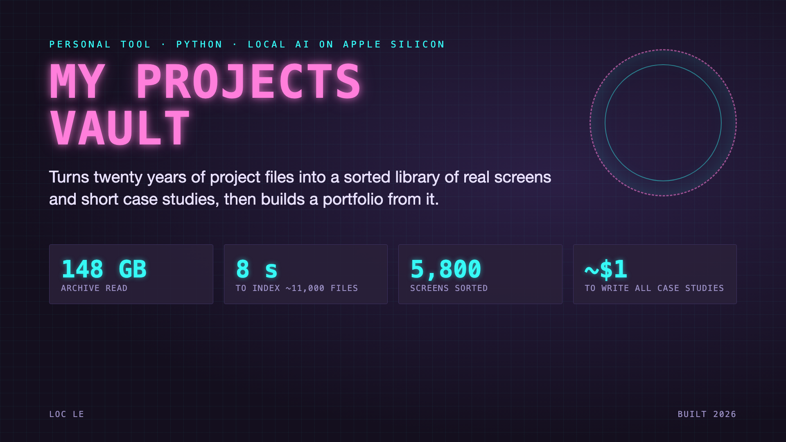
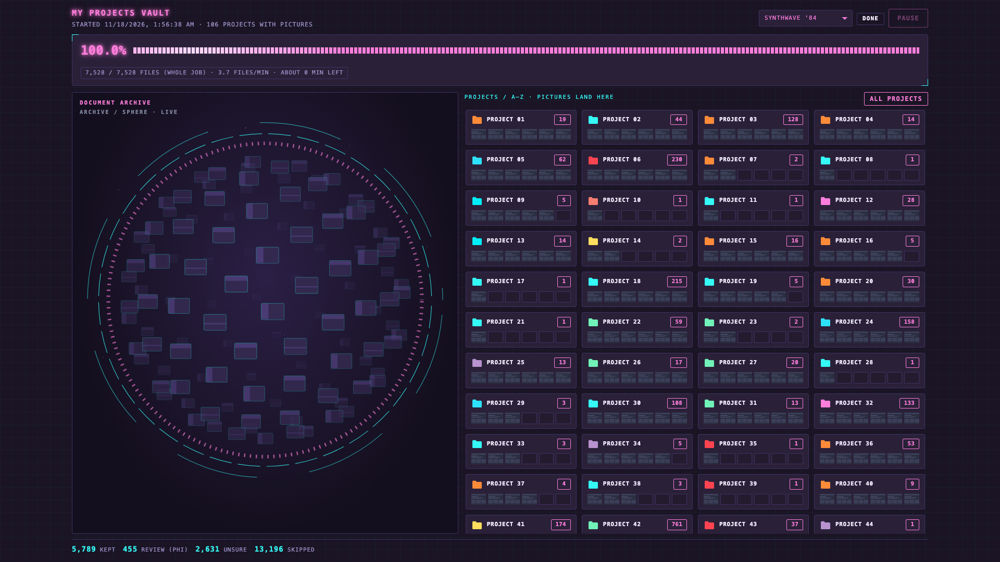
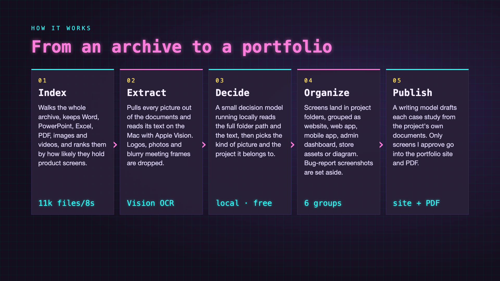
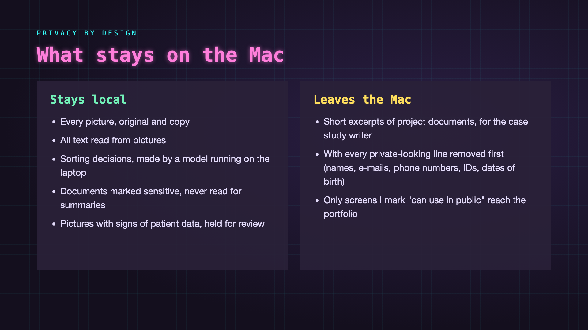

<p align="center">
  
</p>

<p align="center">
  Turn years of project files into a sorted library of real screens and short case studies,<br>
  then build a portfolio from it. Sorting runs on your Mac with a small local AI model.
</p>

<p align="center">
  <a href="https://thienloc-leminh.sgp1.cdn.digitaloceanspaces.com/media/my-projects-vault.html"><b>▶ Watch the 1-minute demo</b></a>
  ·
  <a href="docs/how-it-works.md">How it works</a>
</p>

<p align="center">
  
  
  
</p>

## Why

After twenty years of client work, my history lived in a 148 GB archive of statements of work, slide decks, specs and
screenshots. I wanted a portfolio built from evidence, not from memory. My Projects Vault reads the archive, pulls out the
product screens and diagrams, sorts them into projects, writes a short case study for each one, and builds a portfolio
page and PDF from the screens I approve. On my archive it indexed about 11,000 files in 8 seconds and sorted around 5,800
screens into 211 projects.

## Screenshots

**Live sorting.** Pictures leave the archive sphere and fly into their project folders as they are sorted.


**From an archive to a portfolio, in five steps.**


**Privacy by design.** Pictures and their text never leave the Mac.


## Tech Stack

<p>
  
  
  
  
  
  
  
  
  
</p>

- **Python 3.12** with **SQLite** for the database and plain HTML, CSS and JavaScript for the live page (no framework).
- **Apple Vision** (through PyObjC) reads the text in every picture, on the Mac.
- **[jev-style](https://pypi.org/project/jev-style/)**, a 2B decision model running through **MLX** on Apple Silicon, picks
  the kind, group and project of each picture. It returns probabilities, not text, and costs nothing per call.
- **OpenRouter** with **Gemini 2.5 Flash** writes the case studies (about one US dollar for 200+ projects).
- **Chrome headless** prints the portfolio PDF.

## Features

- **Fast index.** Walks the whole archive, ranks files by how likely they hold product screens, skips junk and sensitive paths.
- **Picture extraction.** Pulls pictures out of Word, PowerPoint, Excel and PDF files; drops logos, photos, small images and
  blurry meeting frames.
- **Local AI sorting.** Each picture gets a kind (screen, diagram...), a group (website, web app, mobile app, admin
  dashboard, store assets, diagram) and a project, decided from the full folder path and its text.
- **Live page.** A sphere of documents, project folders A to Z, pictures flying into place, pause and resume, themes.
- **Review tools.** Per project: pictures by group, a lightbox with zoom, move a picture to another project or group, hide
  annotated bug-report screenshots, mark pictures "can use in public".
- **Case studies.** Problems solved, solution, users, client country, years, platforms, features and tech, written from
  each project's own documents.
- **Portfolio output.** A portfolio page (featured projects in full, the rest as a compact list, most recent first) and a
  matching PDF, built only from approved pictures.

## Getting Started

Requirements: macOS on Apple Silicon, Python 3.12, about 4 GB of disk for the model, and Google Chrome for the PDF.

```bash
git clone https://github.com/<you>/my-projects-vault.git
cd my-projects-vault
uv venv --python 3.12 && uv pip install -e .     # or: python3.12 -m venv .venv && .venv/bin/pip install -e .
cp vault.example.toml vault.toml                  # set the archive path, your name and your agency
```

The tool needs a list of your projects to sort into. Import one from an older catalogue (a SQLite file with a `projects`
table) with `vault import-seed`, or add rows to the `projects` table yourself.

```bash
vault index                                       # list the archive, about 8 s for 11,000 files
vault run --from-index --min-priority 40 --no-claude
vault monitor                                     # open http://127.0.0.1:8791 to watch and review
```

To write case studies, put an OpenRouter key in `~/.config/myprojectsvault/openrouter.key` (one line, `chmod 600`), then:

```bash
vault details --show --only "some project"        # see exactly what would be sent
vault details                                     # write all of them
vault publish --site ~/my-site/portfolio --pdf ~/Desktop/Portfolio.pdf
```

The first run downloads the JEV model (about 3.8 GB) into the Hugging Face cache. macOS may ask for Full Disk Access for
Terminal if the archive is on an external drive.

## Commands

| Command | What it does |
|---|---|
| `vault index` | List every image, video and picture-holding document with a priority |
| `vault run` | Extract, read and sort pictures (`--from-index`, `--min-priority`, `--retry-unsure`, `--no-claude`) |
| `vault monitor` | The live page and review tools on 127.0.0.1 |
| `vault categorize` | Give kept pictures a group |
| `vault annotations` | Find bug-report screenshots with drawn-on markup |
| `vault reproject` | Ask JEV again which project each document belongs to (`--dry` to preview) |
| `vault consolidate` | Fold many catalogue entries into portfolio projects (`data/portfolio-groups.json`) |
| `vault dates` | Set each project's date from its earliest picture or video |
| `vault details` | Write case studies through OpenRouter (`--show`, `--only`, `--redo`) |
| `vault export` | The portfolio as JSON, with every sharing rule applied |
| `vault publish` | Build the portfolio page and PDF from the export |
| `vault stats` | Counts of pictures by status and kind |

## Privacy

- Pictures, the text read from them, and every sorting decision stay on the Mac. The live page listens on 127.0.0.1 only.
- The case-study writer gets short excerpts of a project's own documents, after every line that looks private (names,
  e-mail addresses, phone numbers, IDs, dates of birth, addresses) is removed. Documents marked sensitive are skipped.
- Nothing is public by default. Only pictures you mark "can use in public" reach the portfolio, and internal notes such as
  results never leave the vault.
- Personal settings live in `vault.toml`; the database, pictures and keys live outside the repository and are never committed.

## Status

A personal tool, shared as it is. It was built for one archive on one Mac, so expect to adjust the rules (folder names,
priorities, groups) to yours. See [How it works](docs/how-it-works.md) for the design and the lessons learned.

## License

[MIT](LICENSE) · built by Loc Le
